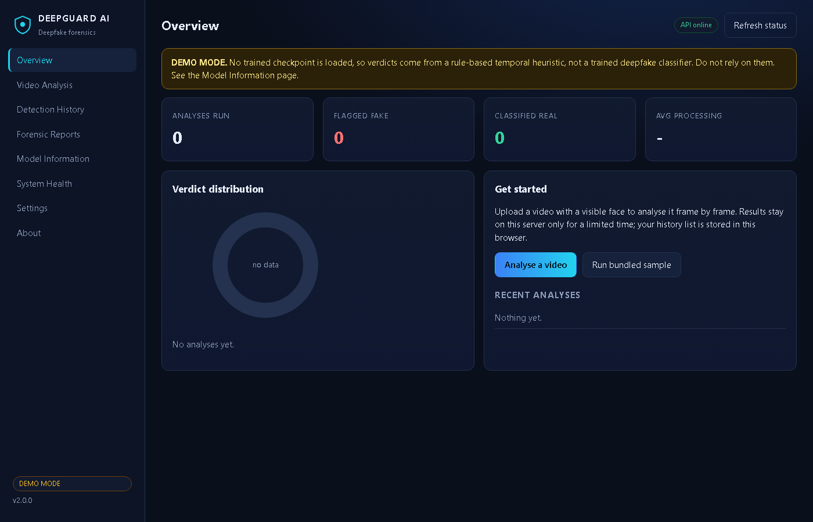
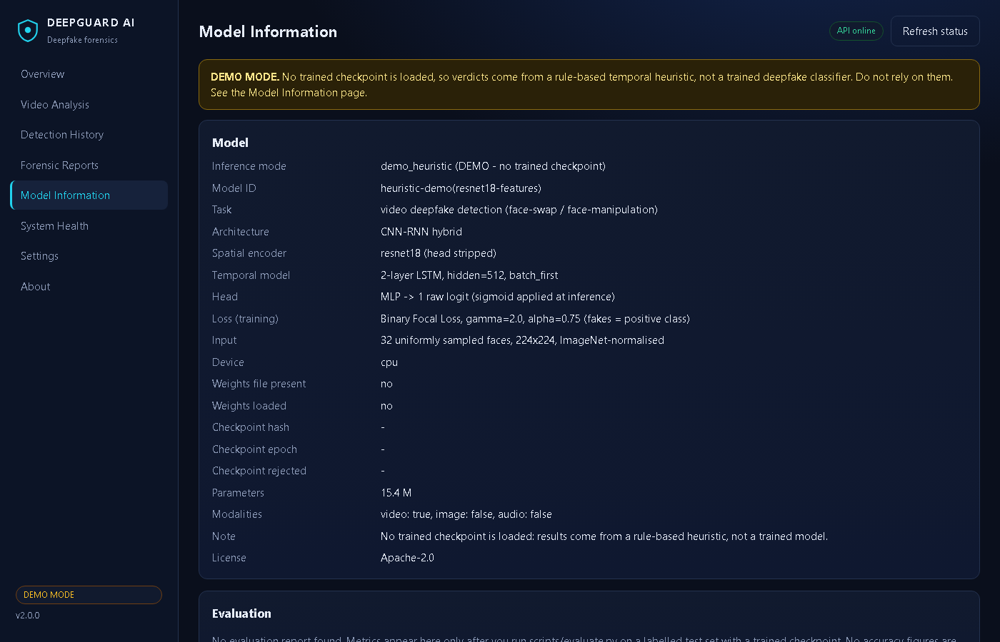
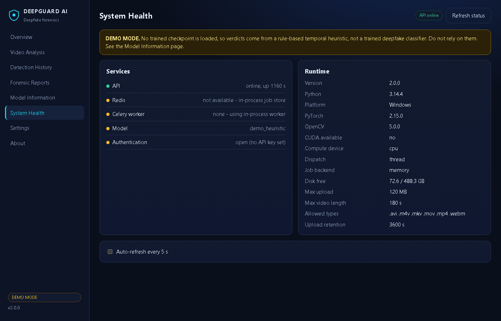

# DEEPGUARD AI

**AI-powered deepfake video detection and digital media forensics using deep learning, computer vision, ResNeXt-50 and LSTM.**

Maintained by **Abdul Majid Jamil**. 



> ## Read this first - what this project is and is not
> * **No trained model is included.** Out of the box the app runs in **`demo_heuristic` mode**: a
>   rule-based temporal-consistency check on face crops. It is clearly labelled as a demo everywhere
>   (dashboard banner, API field `is_demo`, PDF/JSON reports) and **must not be used as a deepfake detector**.
> * You get a real detector only after you **train (or supply) a checkpoint** for the
>   ResNeXt-50 + LSTM model (see [Training](#training-and-evaluation)). The loader refuses any file that
>   fails validation and then falls back to the labelled demo mode.
> * **No accuracy figure is claimed.** A confidence score is the model's output for one clip, not a
>   probability that the verdict is correct. Deepfake detectors generalise poorly to new generators,
>   compression and unseen faces. Use results as one signal in a forensic process, never as proof.
> * Video only. **Image and audio detection are not implemented** (they need different models; the UI
>   does not pretend otherwise).

## Features

| Area | What works |
|---|---|
| Detection | Video upload (drag and drop), 32-frame uniform sampling, YuNet/MTCNN/Haar face detection, landmark alignment, ResNeXt-50 (or EfficientNet-B3 / ResNet-18) + 2-layer LSTM, Binary Focal Loss training |
| Honesty | `trained_model` vs `demo_heuristic` inference modes, safe checkpoint validation, warnings and a disclaimer in every result |
| Multi-face | Up to 3 tracked people per clip, per-person scores, clear "no face / too few faces" errors |
| Frame-level | Per-frame anomaly trace and suspicious-frame thumbnails (a "where to look" cue, not a classifier output) |
| Output | label, confidence, manipulation probability, frames analysed, faces found, duration, model id, mode, device, warnings |
| Reports | PDF and JSON download per analysis |
| Dashboard | Overview, Video Analysis, Detection History (stored in your browser), Forensic Reports, Model Information, System Health, Settings, About |
| API | FastAPI, OpenAPI docs at `/api/docs`, optional API key, rate limiting, sanitised errors |
| Queue | Celery + Redis; automatic in-process fallback when Redis/Celery is unavailable |
| Training | Dataset validation, train/val leakage detection, class-imbalance sampler, checkpointing, resume, early stopping, seeds, accuracy/precision/recall/F1/ROC-AUC/confusion matrix/FPR/FNR |
| Ops | `install.sh`, `start.sh`, `stop.sh`, `health_check.sh`, Dockerfile, docker-compose, GitHub Actions CI |

Screenshots (captured on a CPU-only dev machine with the light `resnet18` backbone in demo mode):

| Model information | System health |
|---|---|
|  |  |

## Architecture

```
 Browser dashboard (web/)                       Optional clients (curl, scripts)
        |  HTTPS / HTTP                                   |
        v                                                 v
 +------------------------------ FastAPI (main.py) -------------------------------+
 | validation: size, extension, MIME, magic bytes | rate limit | API key | CSP      |
 | UUID filename -> data/uploads/                                                   |
 +---------------+------------------------------------------+-----------------------+
                 | Celery task (if Redis + worker alive)    | else: in-process thread
                 v                                          v
          Redis broker  <----- job state (JobStore) ----->  in-memory job dict
                 |
                 v
 worker.py  ->  pipeline.py: probe -> sample 32 frames -> detect faces -> track -> align 224x224
            ->  inference.py: ResNeXt-50 per-frame features -> LSTM -> logit -> sigmoid
                 (trained_model)  or  temporal heuristic (demo_heuristic, labelled)
            ->  result JSON  ->  GET /api/v1/status/{id}  ->  PDF / JSON report
```

Tech stack: Python 3.10+, FastAPI, Uvicorn, Celery, Redis, PyTorch, torchvision, OpenCV, NumPy, ReportLab; vanilla JS dashboard (no external requests, strict CSP).

## Run it

### Kali Linux / Debian / Ubuntu

```bash
git clone <your-repo-url> DEEPGUARD-AI && cd DEEPGUARD-AI
chmod +x *.sh                 # needed if the files came from a zip
./install.sh --apt --cpu      # venv + packages (--apt installs system packages with sudo, --cpu = small PyTorch wheel)
./start.sh                    # prints the dashboard URL, e.g. http://127.0.0.1:8000/
./health_check.sh             # verifies the API is reachable
./stop.sh                     # stops only the processes start.sh started
```

The scripts check dependencies, ports and Redis, never delete data, never overwrite weights, and
`start.sh` uses a private Redis + Celery worker when `redis-server` is installed; otherwise it runs
the documented in-process fallback and says so. The first run downloads ImageNet backbone weights
(needs internet); set `PRETRAINED_BACKBONE=0` to avoid that (demo mode only).

### Docker

```bash
docker compose up --build     # dashboard at http://127.0.0.1:8000/
docker compose down           # data volume is kept
```

Compose starts Redis (internal network only), the API and a Celery worker.
Put your checkpoint in `weights/deepfake_detector.pth` (mounted read-only) to switch to trained mode.

### Manual / Windows (development)

```bash
python -m venv .venv && source .venv/bin/activate      # Windows: .venv\Scripts\activate
pip install torch torchvision --index-url https://download.pytorch.org/whl/cpu
pip install -r requirements.txt
BACKBONE=resnet18 PRETRAINED_BACKBONE=0 python -m uvicorn main:app --port 8000   # fast offline demo
```

Open <http://127.0.0.1:8000/> and use **Video Analysis** -> *Run bundled sample* to see the whole pipeline
without uploading anything. Configuration lives in `.env` (copy [.env.example](.env.example)).

> Uploaded videos are kept in `data/uploads/` (UUID-named, git-ignored) unless `DELETE_UPLOAD_AFTER=true`
> (the default when `ENVIRONMENT=production`); stale files are also removed by the cleanup task.

## API

Interactive docs: `/api/docs` (disabled when `ENABLE_DOCS=false`). If `API_KEY` is set, send `X-API-Key: <key>`.

| Method | Path | Purpose |
|---|---|---|
| POST | `/api/v1/detect` | multipart `file=@video.mp4` -> `202 {task_id, poll_url}` |
| GET | `/api/v1/status/{task_id}` | progress, stage and (when done) the result |
| POST | `/api/v1/detect/sample` | analyse the bundled synthetic sample clip |
| GET | `/api/v1/report/{task_id}?format=json\|pdf` | download a finished analysis |
| GET | `/api/v1/health` | liveness, job backend, engine mode |
| GET | `/api/v1/model` | model, checkpoint and evaluation info |
| GET | `/api/v1/system` | version, Python/Torch, device, queue backend |

```bash
curl -s -F "file=@clip.mp4" http://127.0.0.1:8000/api/v1/detect          # {"task_id": "..."}
curl -s http://127.0.0.1:8000/api/v1/status/<task_id>
curl -s -o report.pdf "http://127.0.0.1:8000/api/v1/report/<task_id>?format=pdf"
```

Result fields: `label` (REAL/FAKE), `confidence`, `manipulation_probability`, `frames_sampled`,
`faces_detected`, `duration_seconds`, `model_id`, `inference_mode`, `is_demo`, `device`, `persons`,
`suspicious_frames`, `warnings`, `disclaimer`. Errors are short and safe: no paths, tracebacks or secrets.

## Model

* Spatial encoder: ResNeXt-50 (32x4d) by default; EfficientNet-B3 and ResNet-18 selectable with `BACKBONE`.
* Temporal model: 2-layer LSTM (hidden 512) -> MLP -> one logit. Fakes are the positive class.
* Loss: Binary Focal Loss (gamma 2.0, alpha 0.75).
* Checkpoints: loaded with `torch.load(weights_only=True)` and accepted only if tensors are finite and the
  backbone, keys and shapes match exactly. The SHA-256 prefix is shown in the dashboard and reports.
* CPU by default; `DEVICE=cuda` or `auto` uses a GPU if PyTorch can see one (see Limitations).

## Dataset preparation

Use datasets you are licensed to use (FaceForensics++, Celeb-DF, DFDC, ...). They have their own
terms - usually research-only - and **must not be committed or redistributed**. Layout:

```
data/datasets/
  train/real/*.mp4   train/fake/*.mp4
  val/real/*.mp4     val/fake/*.mp4
  test/real/*.mp4    test/fake/*.mp4        # for scripts/evaluate.py
```

```bash
python scripts/validate_dataset.py --data data/datasets        # counts, class balance, leakage (non-zero exit on errors)
```

Leakage checks flag byte-identical clips across splits and shared FaceForensics++ identities
(`123` / `123_456`) between train and validation/test. Split by **identity**, not by clip.

## Training and evaluation

```bash
python scripts/train.py --data data/datasets --epochs 20 --backbone resnext50 --batch-size 4 \
       --out weights/deepfake_detector.pth            # add --device cuda on a GPU machine
python scripts/train.py ... --resume runs/<run>/last.pt   # continue an interrupted run
python scripts/evaluate.py --data data/datasets --split test --weights weights/deepfake_detector.pth \
       --dataset-name "Celeb-DF v2 test"
```

Training freezes the backbone for the first epochs, uses a class-balanced sampler by default, seeds
everything, early-stops on validation ROC-AUC, writes logs to `runs/`, and **refuses to overwrite an existing
checkpoint** without `--overwrite`. `evaluate.py` writes `weights/eval_report.json` (accuracy, precision,
recall, F1, ROC-AUC, confusion matrix, FPR, FNR) which the **Model Information** page displays - until
you run it, the dashboard says no evaluation exists. The test split must not overlap training data.

## Tests

```bash
pip install -r requirements-dev.txt
BACKBONE=resnet18 PRETRAINED_BACKBONE=0 python -m pytest tests -q
```

73 tests cover the API (health/model/detect/status/report), upload validation (extension, MIME, magic
bytes, empty, oversize), corrupt and face-less videos, auth and rate limiting, error sanitisation, the
job store with a fake Redis and Redis failure, the Celery task (eager mode), checkpoint loading
(valid, wrong backbone, bad shapes, NaN, corrupt, pickle payload, missing), CPU inference, face detection and
frame sampling, metrics versus scikit-learn, dataset leakage, and a train -> evaluate smoke test.
They use synthetic videos, so the training test proves the plumbing only - **it says nothing about detection accuracy.**
GitHub Actions ([ci.yml](.github/workflows/ci.yml)) runs syntax/lint checks, a secret scan and the tests.

## Security

Upload size/type/magic-byte validation, UUID filenames, path sandbox, rate limits, optional API key
(header only), strict CSP, sanitised errors, JSON-only Celery serialisation, safe checkpoint loading.
Details and the production checklist are in [SECURITY.md](SECURITY.md).

## Limitations

* No trained checkpoint ships with the project; demo mode is not a detector.
* Not tested here: a real Redis broker with a Celery worker, the Docker images, the shell scripts on a
  real Kali machine, GPU/CUDA, and any trained-model accuracy. The scripts pass `bash -n` and `stop.sh`/
  `health_check.sh`/`start.sh` were exercised only on Windows Git Bash; the Redis path is covered by tests with a
  fake Redis and eager Celery.
* Detection quality will depend on your training data and will drop on unseen generators, heavy
  compression, low resolution, occlusion and non-frontal faces.
* Image and audio detection and multi-model comparison are not implemented.
* Detection history is stored in the browser only (not shared across devices or users).
* Rate limiting is per process. The in-process fallback worker runs inside the API process.

## License and attribution

Apache License 2.0 ([LICENSE](LICENSE)).
files **Copyright 2026 Abdul Majid Jamil** ([NOTICE](NOTICE), [DERIVATION.md](DERIVATION.md)). Third-party
libraries, ImageNet/YuNet weights, datasets and any checkpoint you train keep their own licenses.

Contributing: [CONTRIBUTING.md](CONTRIBUTING.md) - Changes: [CHANGELOG.md](CHANGELOG.md)

## GitHub repository checklist

* Name: `DEEPGUARD-AI`
* Description: *AI-powered deepfake video detection and digital media forensics using deep learning, computer vision, ResNeXt-50 and LSTM.*
* Topics: `deepfake-detection`, `artificial-intelligence`, `computer-vision`, `digital-forensics`, `pytorch`, `fastapi`, `lstm`, `resnext`, `video-analysis`, `cybersecurity`
* Replace the `Contact:` line in `.well-known/security.txt` and enable private vulnerability reporting.
